<div align="center">

# Whozit

### A shared turn and schedule manager for keeping everyday routines organized.

[](https://www.android.com/)
[](https://kotlinlang.org/)
[](https://developer.android.com/jetpack/compose)
[-informational?style=flat-square)](https://developer.android.com/about/versions/12)
[](https://github.com/theheartbreakid/Whozit/releases)
[](LICENSE)

<br/>

<a href="#-screenshots--visual-showcase">
  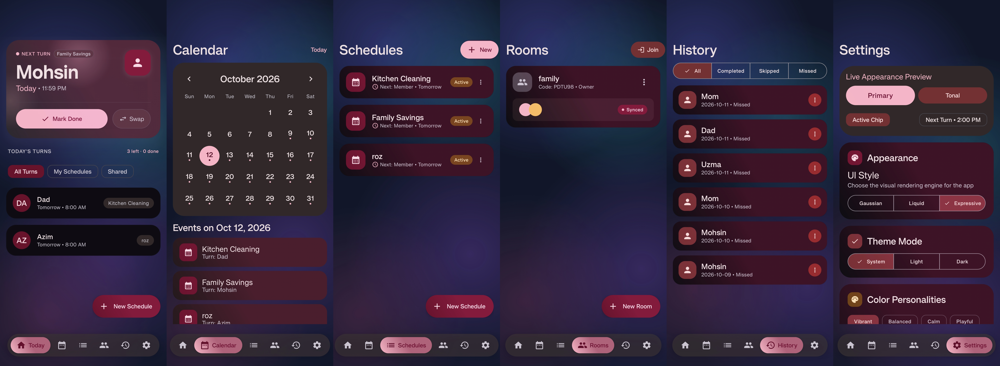
</a>

<p align="center">
  <em>Managing shared routines, turn rotations, and schedule coordination across three distinct UI experiences.</em>
</p>

</div>

---

## 💡 Why Whozit?

When households, roommates, project partners, or teams share recurring responsibilities, tracking who did what and whose turn is next often breaks down into guesswork and scattered chat threads.

**Whozit** solves this everyday problem with clarity and precision:
- **Whose turn is it today?** Immediate glanceability on your daily dashboard.
- **What is coming up?** An interactive multi-schedule calendar and turn projection timeline.
- **What has already been completed?** Comprehensive historical logs with skip/swap audit trails and expense tracking.
- **How do groups stay synchronized?** Lightweight shared rooms with QR-code and room-code joining.
- **What fits your visual style?** Three distinct switchable presentation engines — **Material 3 Expressive**, **Liquid Glass**, and **Gaussian Blur**.

---

## 🎬 In Action

<div align="center">
  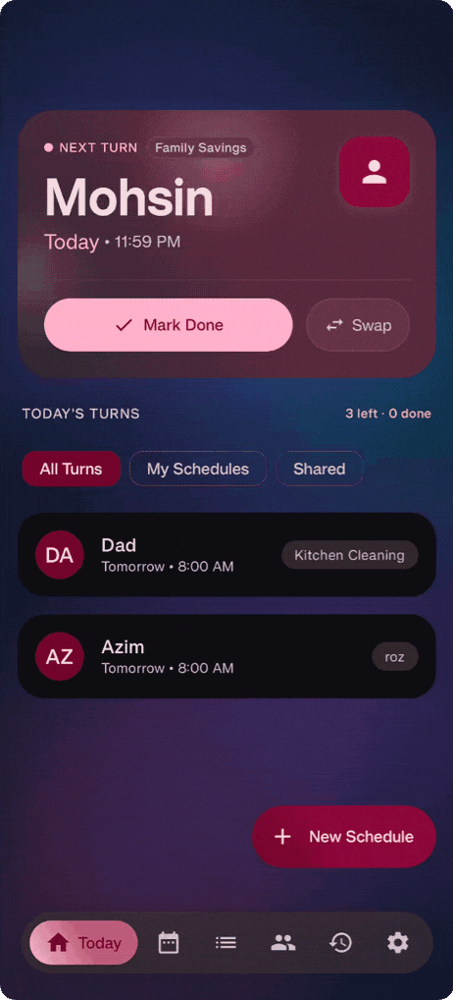
  <p><em>Turn progression, quick completion actions, and routine switching in action.</em></p>
</div>

---

## ✨ Features

### 🔄 Intelligent Turn Rotation
- **Strict Turn Fairness:** Automatically rotates to the next participant upon turn completion.
- **Interactive Actions:** Complete turns with a single tap, record optional expense amounts, swap turns with another participant, or skip turns when schedules change.
- **Overdue & Today Prioritization:** Highlights urgent routines at the top of the Today dashboard.

### 📅 Recurring Schedules & Calendar
- **Flexible Recurrence:** Create daily, weekly (custom weekday selection), monthly (specific day-of-month), or interval-based routines.
- **Schedule Pausing:** Temporarily pause schedules with automatic resume dates without breaking rotation histories.
- **Visual Calendar:** Month-view calendar displaying scheduled occurrences, pending assignments, and completion states day by day.

### 📜 History & Audit Trails
- **Occurrence History:** Searchable, filterable ledger of every completed, skipped, or swapped turn.
- **Financial Turn Support:** For shared expenses (such as grocery or utility rotations), tracks default currency amounts and custom paid amounts per occurrence.

### 👥 Shared Rooms (Local & P2P-Ready)
- **Room Creation & Joining:** Generate 6-character room codes or camera-scannable QR codes using ZXing & CameraX.
- **Participant Roles:** Owner and member roles with live member presence indicators.
- **Offline-First Architecture:** Local-first storage backed by Room with an in-memory broadcast event bus for zero-dependency local network synchronization.

### 🔔 Smart Reminders & In-App Updates
- **Proactive Notifications:** Daily reminders scheduled via `AlarmManager` and `WorkManager` with direct notification action intents.
- **Built-in GitHub Release Updater:** Automatically checks for new GitHub releases via `UpdateManager`, downloads release APKs securely, and launches the system package installer.

---

## 🎨 Three Distinct UI Presentation Modes

Whozit features three fully realized design systems switchable on the fly from **Settings → Appearance**:

| Material 3 Expressive (Default) | Liquid Glass (iOS-Style Refraction) | Gaussian Blur (Translucent Backdrop) |
| :---: | :---: | :---: |
| 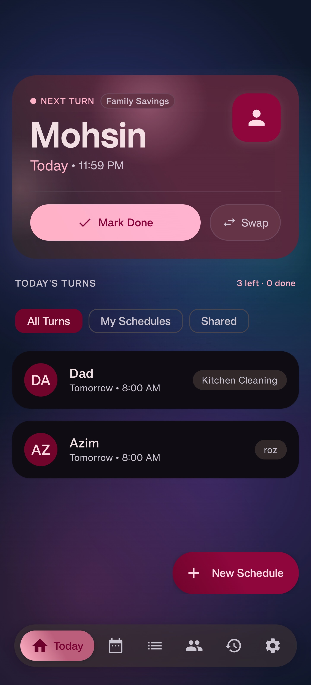 | 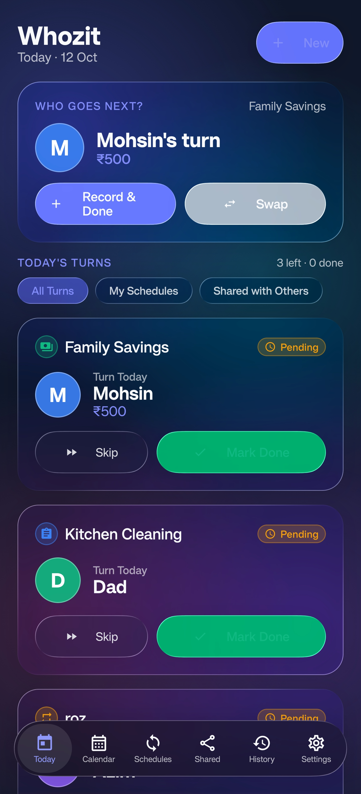 | 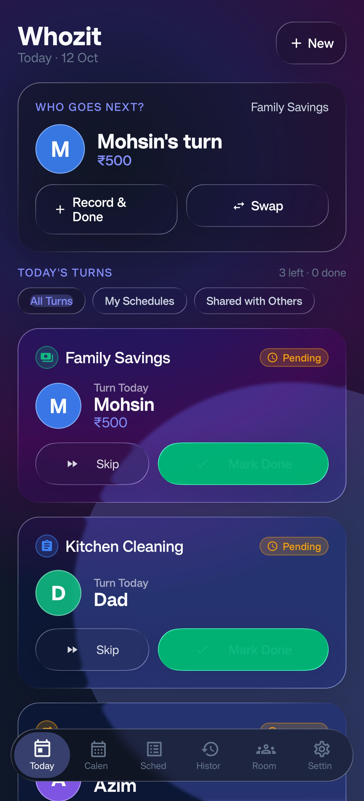 |
| Google M3E design tokens with dynamic fluid shapes, responsive typography, and spring physics. | Native real-time AGSL shader refraction, specular highlights, and chromatic aberrations. | Soft multi-layered Gaussian depth, glass card elevations, and custom wallpaper backgrounds. |

---

## 📸 Screenshots & Visual Showcase

### Material 3 Expressive Showcase
<details open>
<summary><b>Expand Material 3 Expressive Screens</b></summary>
<br/>

| Dashboard | Calendar | Schedules |
| :---: | :---: | :---: |
|  | 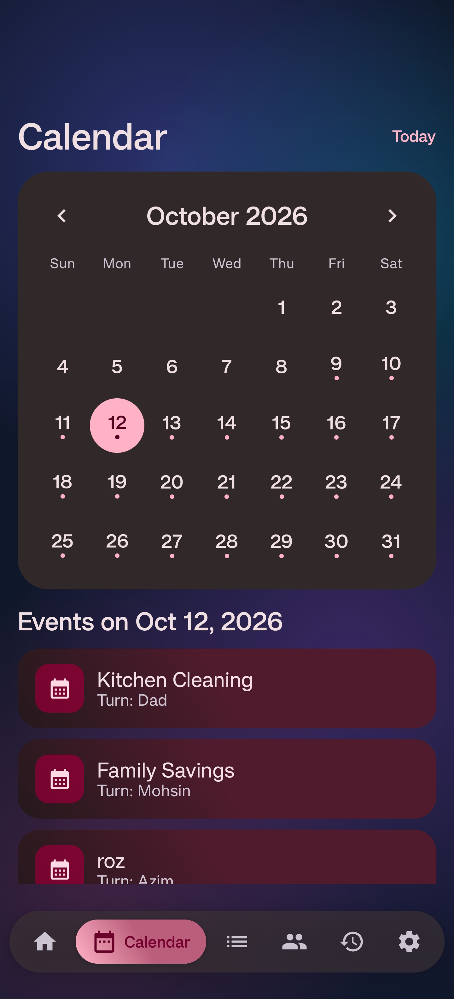 | 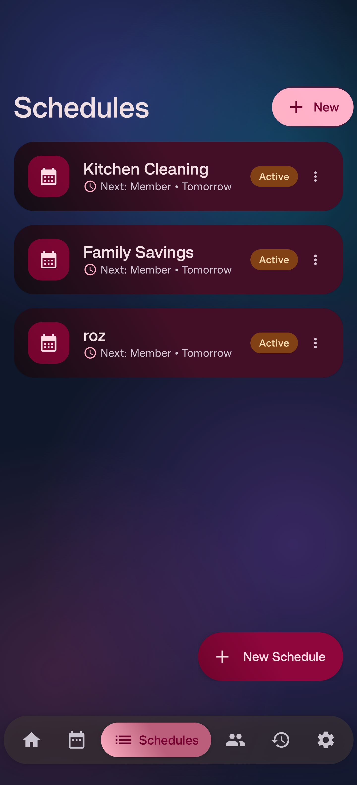 |

| History | Rooms | Settings |
| :---: | :---: | :---: |
| 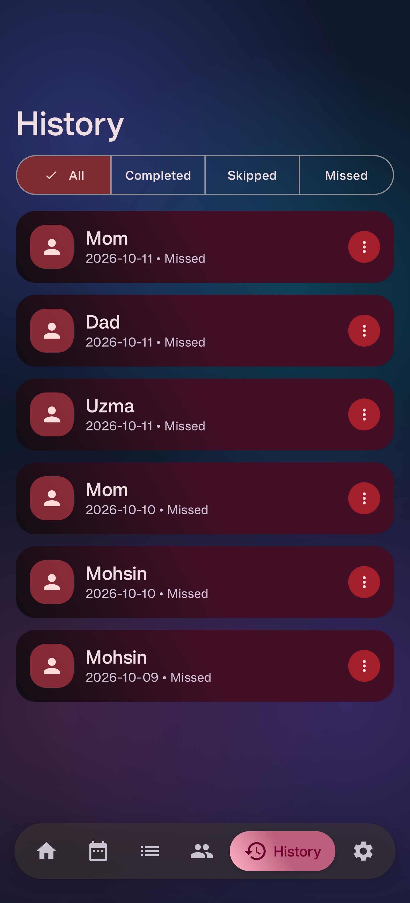 | 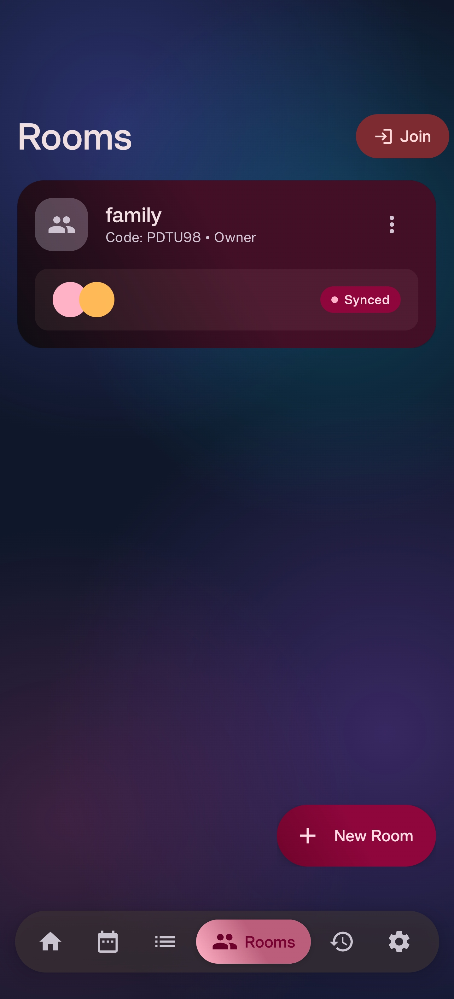 | 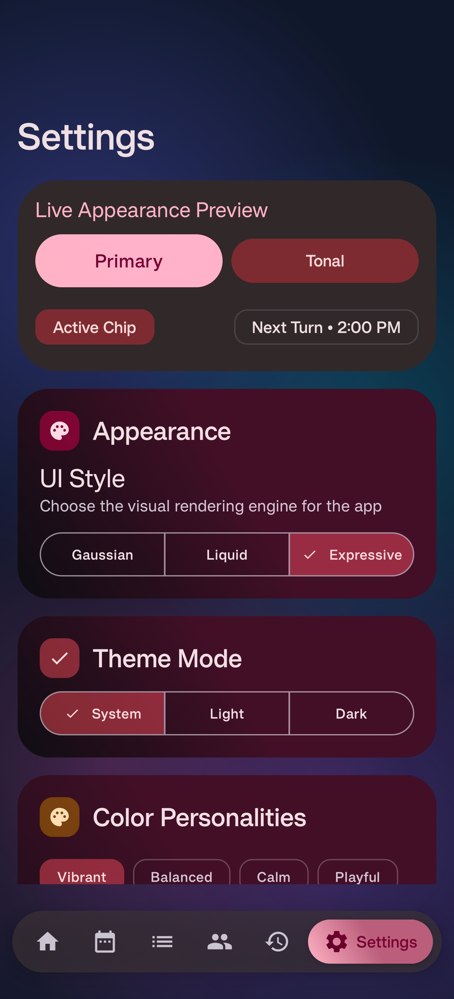 |

</details>

### Liquid UI Showcase & Demonstrations
<details>
<summary><b>Expand Liquid Glass Screens & Motion Demos</b></summary>
<br/>

<div align="center">
  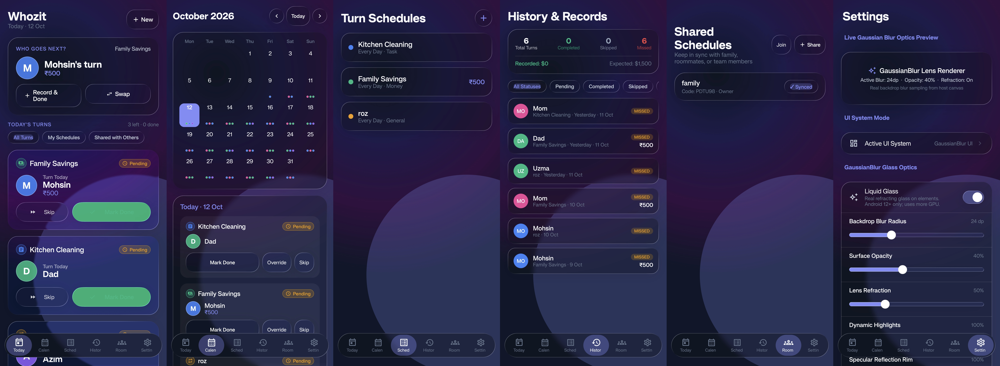
</div>

<br/>

| Interactive Liquid Navigation | Dynamic Background Customization |
| :---: | :---: |
| 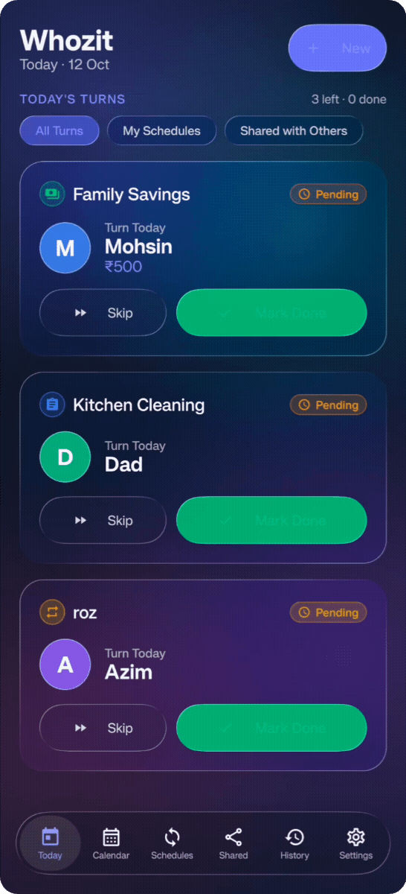 | 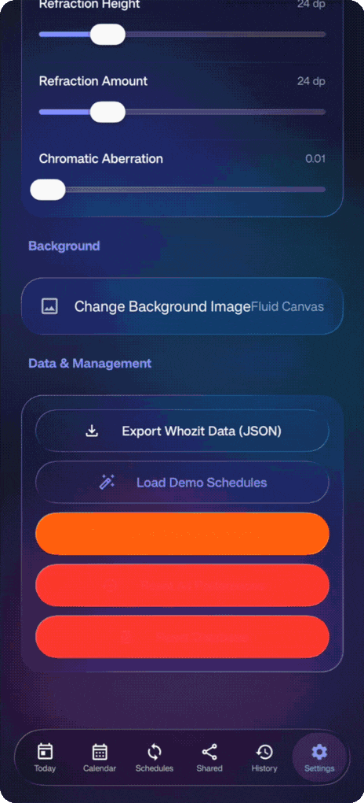 |

| Dashboard | Calendar | Schedules | History |
| :---: | :---: | :---: | :---: |
|  | 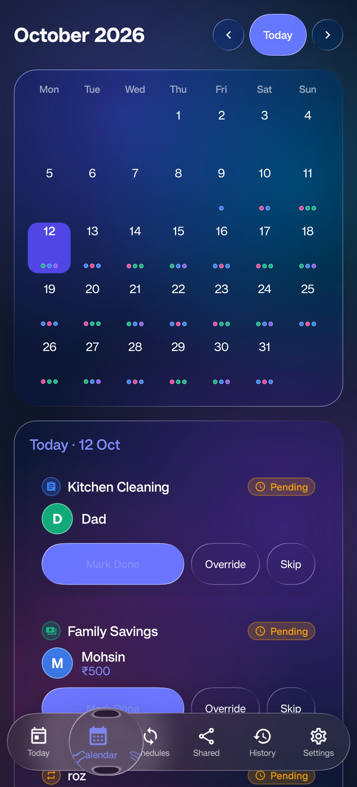 | 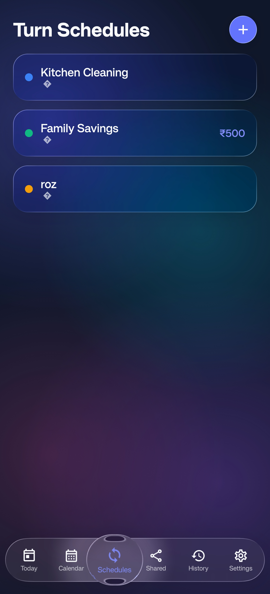 | 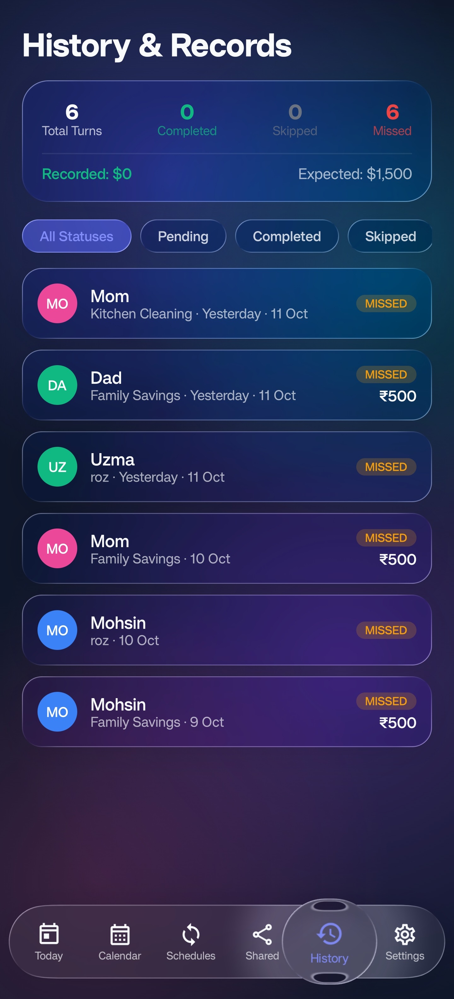 |

</details>

### Gaussian Blur Showcase
<details>
<summary><b>Expand Gaussian Blur Screens & Demo</b></summary>
<br/>

<div align="center">
  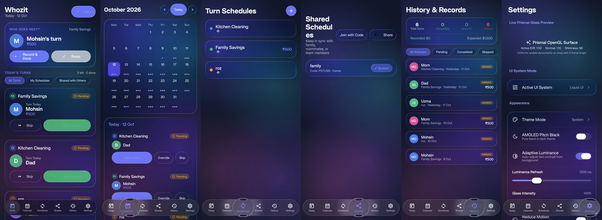
</div>

<br/>

<div align="center">
  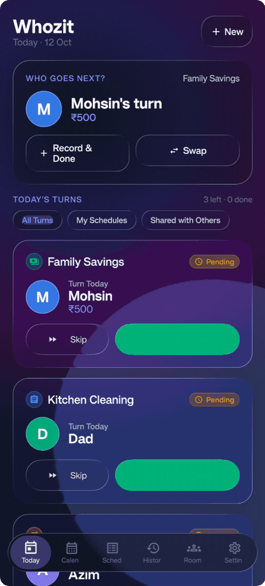
  <p><em>Gaussian depth filtering with adaptive contrast adjustments.</em></p>
</div>

| Dashboard | Calendar | Schedules | Rooms |
| :---: | :---: | :---: | :---: |
|  | 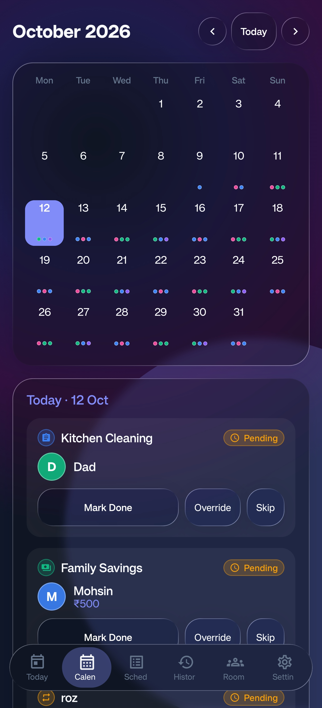 | 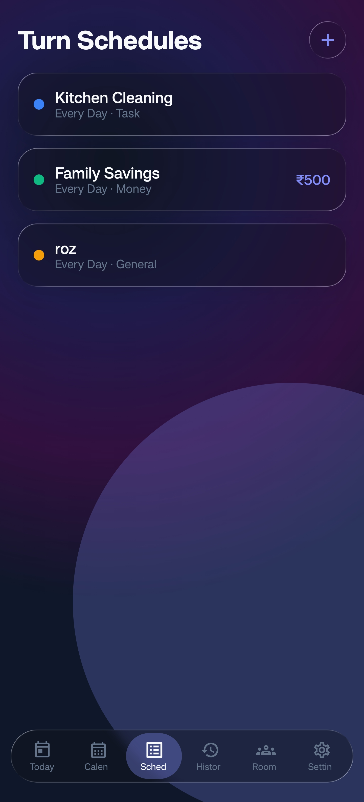 | 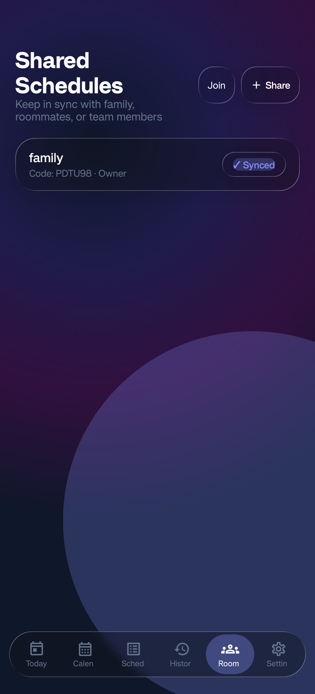 |

</details>

---

## 🏗️ Technical Architecture & Stack

Whozit follows modern Android architectural patterns:

- **Language:** [Kotlin 2.2.10](https://kotlinlang.org/) with JVM Toolchain 21 and Context Parameters
- **UI Framework:** [Jetpack Compose](https://developer.android.com/jetpack/compose) (Compose BOM `2026.06.00`)
- **Design System:** [Material 3 `1.5.0-alpha29`](https://developer.android.com/reference/kotlin/androidx/compose/material3/package-summary) + AndroidX Graphics Shapes (`1.0.1`)
- **Navigation:** AndroidX Navigation Compose (`2.8.4`)
- **Persistence:** [Room Database `2.7.0-alpha13`](https://developer.android.com/training/data-storage/room) with KSP (`2.2.10-2.0.2`)
- **Preferences:** AndroidX DataStore Preferences (`1.1.1`)
- **Concurrency & Reactivity:** Kotlin Coroutines & Flow
- **Background Work:** AndroidX WorkManager (`2.9.1`) + `AlarmManager`
- **QR Codes & Camera:** ZXing Core (`3.5.3`) + CameraX (`1.4.1`)
- **Image Loading:** Coil Compose (`2.6.0`)
- **Shader & Glass Rendering:**
  - Embedded backdrop and shader engine adapted from [Kyant's](https://github.com/Kyant0) backdrop primitives (`io.github.kyant0:shapes:1.2.0`)
  - [Prismal `1.0.5`](https://github.com/styropyr0/Prismal) for OpenGL ES glass-morphism parity

---

## 🛠️ Building from Source

### Prerequisites
- **JDK 21** (Eclipse Temurin, Azul Zulu, or Amazon Corretto)
- **Android SDK** with Platform `37` (Android 16 DP) and Build Tools installed
- Minimum Device / Emulator Version: **Android 12 (API 31)** or higher (AGSL shaders require API 33+ for advanced refraction effects)

### Build Instructions

1. Clone the repository:
   ```bash
   git clone https://github.com/theheartbreakid/Whozit.git
   cd Turnly
   ```

2. Assemble the debug APK:

   **Linux / macOS:**
   ```bash
   ./gradlew assembleDebug
   ```

   **Windows:**
   ```powershell
   .\gradlew.bat assembleDebug
   ```

3. The generated APK will be located at:
   ```
   app/build/outputs/apk/debug/app-debug.apk
   ```

---

## 📦 Releases & Updates

Automated release builds are built via GitHub Actions CI on every release tag.

- Download the latest signed APK directly from the [Releases Page](https://github.com/theheartbreakid/Whozit/releases).
- Whozit includes an internal **Check for Updates** mechanism in **Settings → About** that checks the GitHub Releases API and guides you through updating without requiring third-party app stores.

---

## 🤖 How It Was Built (AI-Assisted Development)

Whozit was built through an **AI-assisted, vibe-coded development workflow**, with manual architectural guidance, bug fixing, and continuous refinement. 

The project explores how AI-assisted programming can unite ambitious mobile interface paradigms (such as AGSL runtime shaders, real-time backdrop blur, and fluid glass dynamics) with practical offline-first routine management in Kotlin and Jetpack Compose.

---

## 💖 Open-Source Acknowledgements

Whozit proudly builds upon and draws inspiration from exceptional open-source libraries:

- **[AndroidLiquidGlass](https://github.com/Kyant0/AndroidLiquidGlass)** by [Kyant](https://github.com/Kyant0) and contributors  
  *Heartfelt thanks to Kyant for open-sourcing the Liquid Glass effect and shape components for Compose. Their innovative AGSL runtime shaders and backdrop capture techniques made Whozit’s Liquid Glass mode possible.*

- **[Prismal](https://github.com/styropyr0/Prismal)** by [styropyr0](https://github.com/styropyr0) and contributors  
  *Thank you to styropyr0 for Prismal, an Android glass-morphism library built with OpenGL ES, which provides rock-solid visual parity across diverse rendering pipelines.*

- **[Haze](https://github.com/chrisbanes/haze)** by [Chris Banes](https://github.com/chrisbanes) and contributors  
  *We credit and thank Chris Banes for Haze, which established the golden standard and conceptual foundation for backdrop blurring and translucent surface treatments in Jetpack Compose.*

*All product names, logos, and brands are property of their respective owners.*

---

## 🤝 Contributing

Contributions, feedback, and issue reports are warmly welcomed! Please review our [Contribution Guidelines](CONTRIBUTING.md) before opening an issue or pull request.

---

## ⚖️ License
 
Whozit is open-source software licensed under the **[Apache License 2.0](LICENSE)**.
 
```text
Copyright 2026 Mohsin Mulla and contributors

Licensed under the Apache License, Version 2.0 (the "License");
you may not use this file except in compliance with the License.
You may obtain a copy of the License at

    http://www.apache.org/licenses/LICENSE-2.0

Unless required by applicable law or agreed to in writing, software
distributed under the License is distributed on an "AS IS" BASIS,
WITHOUT WARRANTIES OR CONDITIONS OF ANY KIND, either express or implied.
See the License for the specific language governing permissions and
limitations under the License.
```
